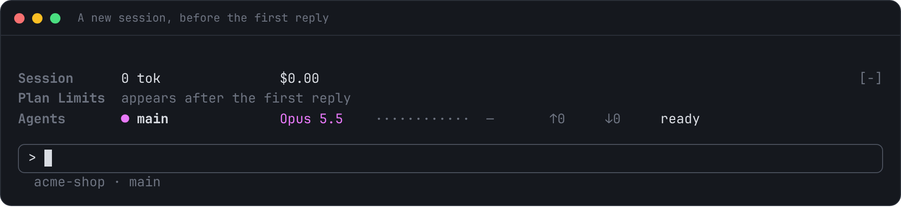
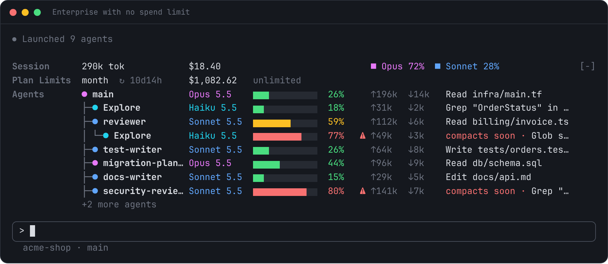
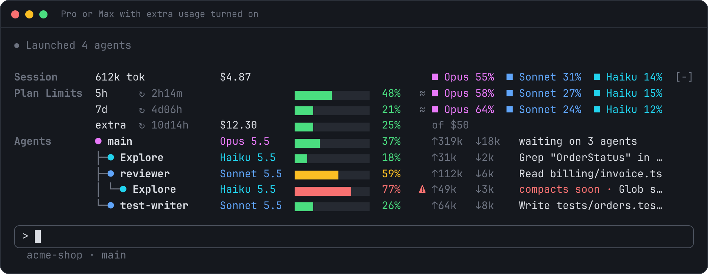
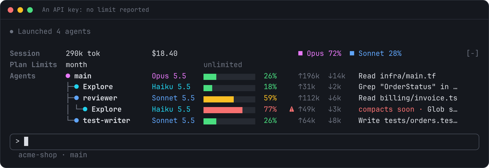
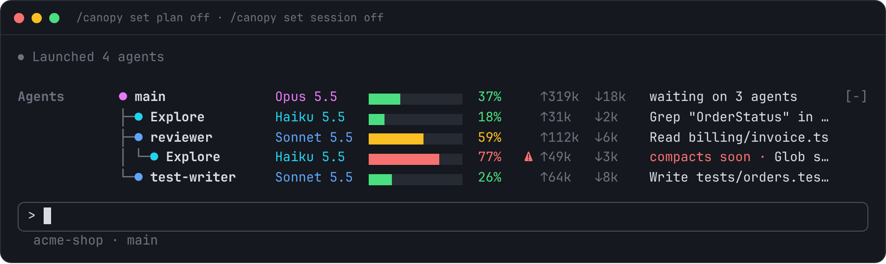
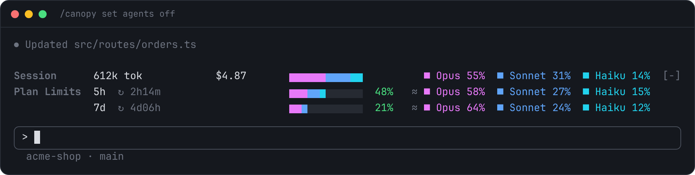

<div align="center">


# Context Canopy

Your session, plan limits and spend, and every running agent, in one band above the Claude Code prompt.

</div>

**A new session.** Your model shows straight away. The 5-hour and 7-day windows appear after Claude's first reply, and an Enterprise month's spend as soon as it's read.



**Pro or Max.** The session by model, the 5-hour and 7-day windows, and every agent's context, tokens and current step. A tree taller than the band has room for ends with a row saying how many agents it hides.


**Enterprise with a spend limit.** What you've spent this month, laid out like the session's cost, then how much of your limit that is. The figure is your account's own, as `/usage` and claude.ai show it.


**Enterprise with no spend limit.** What you've spent this month, with `unlimited` where the bar would be.



## What it shows

| Line | What you see |
| --- | --- |
| **Session** | Tokens and cost for this session, and each model's share |
| **Plan** | Your plan's limits: how full each is, when it resets, and an estimate of which models used it. On Pro and Max that's the 5-hour and 7-day windows. On Enterprise, what you've spent this month and how much of your spend limit that is |
| **Agents** | Every running agent as a tree, however deep: its model, how full its context is, the tokens it has sent and received, and what it is doing right now |

Two rules keep it quick to read:

- **A bar always means how full something is**, a plan window, a spend limit or an agent's context, and its colour is always its health: green, then amber, then red. Its percentage sits next to it in the same colour.
- **Model colours only name models**, never fill a bar: **Fable** violet, **Opus** magenta, **Sonnet** blue, **Haiku** cyan, on model names and the `■` shares.

## Install

You need Claude Code 2.1.309 or newer. There are two ways to install it. Pick one only: installing both shows two bands.

### Option 1: through my plugin marketplace (recommended)

Adds [jonw09/claude-plugins](https://github.com/jonw09/claude-plugins), then installs Context Canopy from it. My other plugins then show up in your plugin browser, ready to install if you want them. Nothing else is installed.

**In Claude Code** (at the prompt of a terminal session), run these one at a time:

```
/plugin marketplace add jonw09/claude-plugins
/plugin install context-canopy@jonw09
```

**From a shell:**

```
claude plugin install context-canopy --marketplace jonw09/claude-plugins
```

**In the desktop app:** click **+** next to the prompt box, choose **Plugins**, then **Add marketplace** and enter `jonw09/claude-plugins`, then **Add plugin**.

### Option 2: on its own

Installs Context Canopy straight from this repo, for when it's the only plugin of mine you want.

**In Claude Code:**

```
/plugin marketplace add jonw09/claude-context-canopy
/plugin install context-canopy@claude-context-canopy
```

**From a shell:**

```
claude plugin install context-canopy --marketplace jonw09/claude-context-canopy
```

**In the desktop app:** as above, but enter `jonw09/claude-context-canopy` as the marketplace.

When asked, press Enter to install for your user. The band appears straight away.

## Try it

Once installed, ask Claude for something that uses a few agents:

> explore this repo with three parallel agents

Watch the tree grow under `main`, each agent's context bar fill, and its current step change as it works. Agents drop off the tree the moment they finish.

## Reading the band

The band sits one blank row above the prompt box, with the session first, then the plan, then the agents.

### Session

Total tokens and cost for this session, and each model's share of the tokens. These follow Claude Code's own session cost:

- **Resuming a session** brings back its cost, and the tokens this machine saw it use.
- **`/clear`** starts a new session, so the cost and tokens start over.

The cost is Claude Code's own figure, as `/cost` shows it, worked out at API prices. On Pro and Max, that's what the session would have cost through the API, not what you pay.

### Plan


- The bar and percentage show how full the window is. They turn **amber from 60%** and **red from 90%**, and you can move both with [`/canopy set`](#settings).
- `↻ 41m` is the time until the window resets. A full window reads `limited`.
- `≈` marks the model shares as an estimate (see [Good to know](#good-to-know)).

The 5-hour and 7-day windows appear after Claude's first reply, when they're first reported.

**The row's name.** Claude Code doesn't tell plugins which plan you're on, so the row is headed **Plan Limits**.

**Team, Enterprise and API keys.** What the line shows depends on what Claude reports for your account:

| Account | What the plan line shows |
| --- | --- |
| Pro, Max, Team seats with usage limits | The 5-hour and 7-day windows, and with extra usage turned on, an `extra` row for it |
| Enterprise, and other seats billed by what they use | `month`: what you've spent this billing period, how much of your spend limit that is, and the limit. With no spend limit, `unlimited` where the bar would be |
| A Claude gateway's spend limit | `month`: how much of the limit is used. A gateway reports no amounts |
| An API key, a cloud provider, or a gateway with no limit | `month` reading `unlimited` |

**Where the month's spend comes from.** It's your account's own figure for the billing period, read from Anthropic just as Claude Code's `/usage` reads it, so it counts every device and claude.ai too. It resets on the 1st. The band asks for it when a session starts, every five minutes, and after Claude replies (at most once a minute). This is the plugin's only network request: Claude Code signs it with your login, and the plugin never sees your credentials. [PRIVACY.md](PRIVACY.md) has the details, and `/canopy set spend off` turns it off.

A spend row goes past 100% if you go over your limit, and reads `limited` when it does.

With extra usage on Pro or Max, the `extra` row sits under the windows it tops up:



With an API key or a cloud provider, there's no limit or spend to read:



### Agents

Each row shows:

```
├─● reviewer        Sonnet 5.5  ▆▆▆▆▆▆▆▆▆▆▆▆  59%     ↑112k  ↓6k    Read billing/invoice.ts
│ │                 │           │             │       │             └ what it is doing now
│ │                 │           │             │       └ tokens sent ↑ and received ↓
│ │                 │           │             └ context used, of the full window
│ │                 │           └ context bar, coloured by health
│ │                 └ model, in its colour
│ └ status: ● running  ◐ waiting  ◌ starting  ○ idle
└ tree guides showing who started whom
```

The tokens are counted the same way as the session line, so all the agents add up to the session's total. Main counts from the start of the session, and every other agent from its first request.

Context colours are tied to the point where Claude Code **auto-compacts** the conversation, not to the raw window size:

| Colour | When | What to do |
| --- | --- | --- |
| 🟩 Green | under 60% of the way to auto-compact | nothing |
| 🟨 Amber | 60% to 89% of the way | long contexts start to lose quality from here |
| 🟥 Red, `⚠ compacts soon` | 90% of the way or more | consider `/compact`, or let it happen |

These are the same 60% and 90% points as the plan line, and [`/canopy set`](#settings) moves them for both.

The main row names your model from the start, and changes as soon as you switch with `/model`. If a request falls back to another model, the row shows the one that answered.

**A tall tree** is cut to fit the room Claude Code gives the band, and ends with a row such as `+3 more agents`, adding `⚠ 1 compacts soon` if any of the hidden agents are near compacting. `/canopy show` prints the whole tree.

**Long agent names** get up to half as much room again in a terminal 120 columns or wider, before they're cut.

## Commands

| Command | What it does |
| --- | --- |
| `/canopy` | Collapse the band to one line, or expand it again |
| `/canopy collapse` / `/canopy expand` | Set it one way |
| `/canopy show` | Print the band as text (for places that can't draw it, see below) |
| `/canopy show 80` | The same, at a set width |
| `/canopy status` | Check whether the band can be drawn here, when your spend was last read, and any error |
| `/canopy set …` | Change a setting (see [Settings](#settings)) |
| `/canopy reset` | Put every setting back to its default |


In a narrow terminal the band drops the bars and token counts, shortens model names, drops the pence from $1,000 and keeps every percentage in its column:


## Settings

There's nothing to set up: the defaults suit most people. To change one, use `/canopy set`. Changes apply straight away and are kept for later sessions.

| Command | Default | What it does |
| --- | --- | --- |
| `/canopy set amber 70` | 60 | Turn amber from this %: of a plan window used, or of the way to auto-compact for context |
| `/canopy set red 95` | 90 | Turn red from this %, measured the same way |
| `/canopy set plan off` | on | The plan line |
| `/canopy set session off` | on | The session line |
| `/canopy set agents off` | on | The agent tree |
| `/canopy set split off` | on | The `≈` model shares on the plan line |
| `/canopy set spend off` | on | Reading your spend this month from Anthropic, and the row that shows it (see [Privacy](#privacy)) |

For example, to keep only the agent tree:

```
/canopy set plan off
/canopy set session off
```



Or to keep the session and plan lines, without the tree:

```
/canopy set agents off
```



## Where it works

| Where | Band | `/canopy show` |
| --- | --- | --- |
| Claude Code in a terminal | ✅ | ✅ |
| Claude desktop app (Code tab) | ✅ | ✅ |
| Claude mobile app or web, viewing a cloud session | ❌ the app doesn't draw plugin bands | ✅ |

If the band doesn't appear, run `/canopy status`. It lists which apps are attached and whether any of them asked for the band.

## Good to know

- **The plan's model shares are an estimate.** Claude reports one percentage per window, not a split by model. Context Canopy logs the usage it sees on this machine and splits each window by that. It can't see claude.ai or your other devices.
- **How tokens are counted.** Fresh input, output and cache writes count in full. Cache reads count at a tenth, which is how they're priced, so the totals reflect real usage rather than the same context re-read on every request. Each agent's ↑ sent and ↓ received counts work the same way.
- **Subagent windows.** Agents get a 200k context window, or 1M for `[1m]` models, unless they run on the same model as the main session.
- **Teammates in their own pane** show in the tree with `—` for context, because their usage isn't visible to this session.
- **The month's spend relies on the request `/usage` makes**, which isn't a published API. If Anthropic changes it, the band can't read your spend: the month then reads `unlimited` with no amount until the plugin is updated, and `/canopy status` says what Anthropic answered.
- **Claude Code updates.** Context Canopy uses Claude Code's plugin API, which is still in early access, so a Claude Code update can occasionally break the band. If it disappears, run `/canopy status`, update the plugin, and [report a problem](https://github.com/jonw09/claude-context-canopy/issues) if that doesn't fix it.

## Privacy

Context Canopy keeps everything on your machine, with one exception: it asks Anthropic what your account has spent this month, the same request Claude Code's own `/usage` makes. Claude Code signs that request with your login and sends it to Anthropic alone, and the plugin never sees your credentials. It sends nothing about your work. `/canopy set spend off` stops it.

Otherwise it calls no model, sends nothing anywhere and changes nothing: every event it hooks is passed on unchanged. To show what each agent is doing, it reads the tool each agent calls and that call's main argument (a file path, command or search), and holds it in memory for the session only. It saves only numbers on this machine (hourly token counts per model, each session's tokens per model, and your settings), never prompts, file names or content.

[PRIVACY.md](PRIVACY.md) sets out exactly what it reads, sends, keeps and adds.

## Update or remove

From a shell (restart Claude Code after an update). Update the marketplace you installed from: `jonw09` for option 1, `claude-context-canopy` for option 2.

```
claude plugin marketplace update jonw09
claude plugin update context-canopy
claude plugin disable context-canopy
claude plugin uninstall context-canopy
```

## Licence

[MIT](LICENSE) © 2026 jonw09
