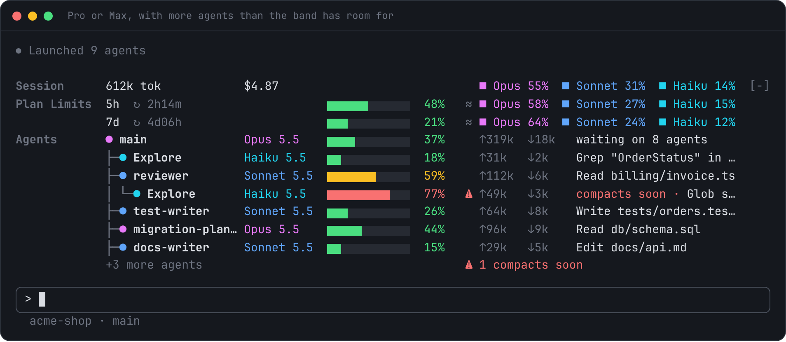
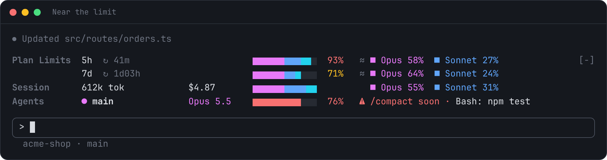
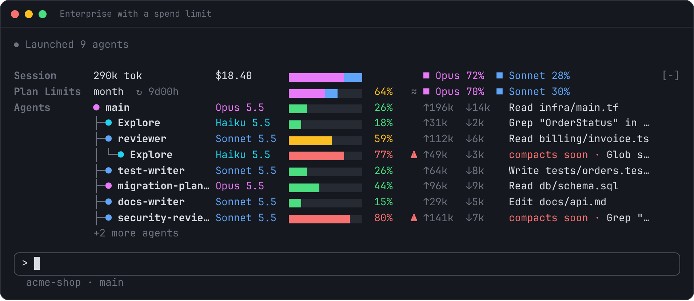
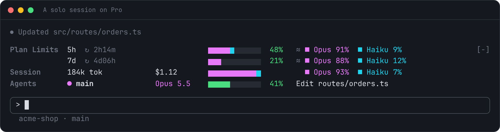
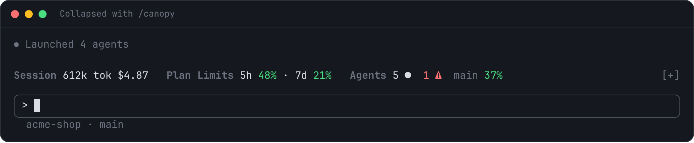
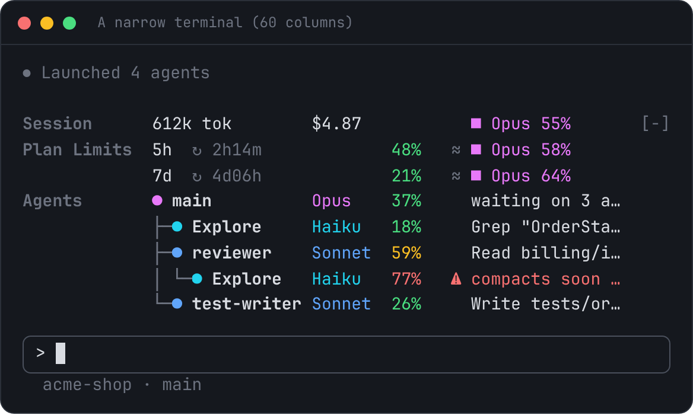

<div align="center">


# Context Canopy

Your plan limits, session usage and every running agent, in one band above the Claude Code prompt.

</div>



## What it shows

| Line | What you see |
| --- | --- |
| **Plan** | Each usage window on your plan (5-hour, 7-day, or a spend limit): how full it is, when it resets, and an estimate of which models used it |
| **Session** | Tokens and cost for this session, split by model |
| **Agents** | Every running agent as a tree, however deep: its model, how full its context is, and what it is doing right now |

Each model keeps one colour everywhere: **Fable** violet, **Opus** magenta, **Sonnet** blue, **Haiku** cyan. Green, amber and red are kept for one job only: how full something is.

## Install

You need Claude Code 2.1.306 or newer.

**In Claude Code** (at the prompt of a terminal session), run these one at a time:

```
/plugin marketplace add jonw09/claude-context-canopy
/plugin install context-canopy@claude-context-canopy
```

Press Enter to install for your user. The band appears straight away.

**From a shell:**

```
claude plugin install context-canopy --marketplace jonw09/claude-context-canopy
```

**In the desktop app:** click **+** next to the prompt box, choose **Plugins**, then **Add marketplace** and enter `jonw09/claude-context-canopy`, then **Add plugin**.

It's also listed in [jonw09/claude-plugins](https://github.com/jonw09/claude-plugins) alongside my other plugins, where it installs as `context-canopy@jonw09`.

## Try it

Once installed, ask Claude for something that uses a few agents:

> explore this repo with three parallel agents

Watch the tree grow under `main`, each agent's context bar fill, and its current step change as it works. Agents drop off the tree the moment they finish.

## Reading the band

### Plan



- The bar shows how full the window is, coloured by the models that used it.
- The percentage turns **amber from 60%** and **red from 90%**. You can move both with [`/canopy set`](#settings).
- `↻ 41m` is the time until the window resets. A full window reads `limited · resets in 38m`.
- `≈` marks the model split as an estimate (see [Good to know](#good-to-know)).

The plan line appears after Claude's first reply, when your limits are first reported.

**The row's name.** Claude Code doesn't tell plugins which plan you're on, so the row is headed **Plan Limits**.

**Team, Enterprise and API keys.** What the line shows depends on what Claude reports for your account:

| Account | What the plan line shows |
| --- | --- |
| Pro, Max, Team seats with usage limits | The 5-hour and 7-day windows |
| A spend limit (organisations using a Claude gateway) | A `spend` window: the percentage used and when it resets. Claude reports the percentage only, not the dollar amounts. |
| No limits reported (an uncapped seat) | The line is left out. |
| API key | The line is left out. The session line shows what you've spent. |



### Session

Total tokens and cost for this session, with a bar and percentages split by model.

### Agents



Each row shows:

```
├─● reviewer        Sonnet 5.5  ▆▆▆▆▆▆▆▆▆▆▆▆  59%   Read billing/invoice.ts
│ │                 │           │             │     └ what it is doing now
│ │                 │           │             └ context used, of the full window
│ │                 │           └ context bar, coloured by health
│ │                 └ model, in its colour
│ └ status: ● running  ◐ waiting  ◌ starting  ○ idle
└ tree guides showing who started whom
```

Context colours are tied to the point where Claude Code **auto-compacts** the conversation, not to the raw window size:

| Colour | When | What to do |
| --- | --- | --- |
| 🟩 Green | under 60% of the way to auto-compact | nothing |
| 🟨 Amber | 60% to 89% of the way | long contexts start to lose quality from here |
| 🟥 Red, `⚠ compacts soon` | 90% of the way or more | consider `/compact`, or let it happen |

These are the same 60% and 90% points as the plan line, and [`/canopy set`](#settings) moves them for both.

## Commands

| Command | What it does |
| --- | --- |
| `/canopy` | Collapse the band to one line, or expand it again |
| `/canopy collapse` / `/canopy expand` | Set it one way |
| `/canopy show` | Print the band as text (for places that can't draw it, see below) |
| `/canopy show 80` | The same, at a set width |
| `/canopy status` | Check whether the band can be drawn here, and show any error |
| `/canopy set …` | Change a setting (see [Settings](#settings)) |
| `/canopy reset` | Put every setting back to its default |



In a narrow terminal the band drops the bars, shortens model names and keeps every number in its column:



## Settings

There's nothing to set up: the defaults suit most people. To change one, use `/canopy set`. Changes apply straight away and are kept for later sessions.

| Command | Default | What it does |
| --- | --- | --- |
| `/canopy set amber 70` | 60 | Turn amber from this %: of a plan window used, or of the way to auto-compact for context |
| `/canopy set red 95` | 90 | Turn red from this %, measured the same way |
| `/canopy set plan off` | on | The plan line |
| `/canopy set session off` | on | The session line |
| `/canopy set agents off` | on | The agent tree |
| `/canopy set split off` | on | The `≈` model split on the plan line |

## Where it works

| Where | Band | `/canopy show` |
| --- | --- | --- |
| Claude Code in a terminal | ✅ | ✅ |
| Claude desktop app (Code tab) | ✅ | ✅ |
| Claude mobile app or web, viewing a cloud session | ❌ the app doesn't draw plugin bands | ✅ |

If the band doesn't appear, run `/canopy status`. It lists which apps are attached and whether any of them asked for the band.

## Good to know

- **The plan model split is an estimate.** Claude reports one percentage per window, not a split by model. Context Canopy logs the usage it sees on this machine and splits each window by that. It can't see claude.ai or your other devices.
- **How tokens are counted.** Fresh input, output and cache writes count in full. Cache reads count at a tenth, which is how they're priced, so the totals reflect real usage rather than the same context re-read on every request.
- **Subagent windows.** Agents get a 200k context window, or 1M for `[1m]` models, unless they run on the same model as the main session.
- **Teammates in their own pane** show in the tree with `—` for context, because their usage isn't visible to this session.

## Privacy

Context Canopy only reads, and nothing leaves your machine. It makes no network requests, calls no model and sends nothing anywhere.

- **What it reads:** this session's token counts, cost and rate-limit windows, the list of running agents, and the apps attached to the session (for `/canopy status`). As Claude works, it reads each agent's model and token counts and the tool each one calls, with that tool's main argument (a file path, search pattern or shell command), to show what each agent is doing. That activity is held in memory for the session only and is never saved.
- **What it stores:** an hourly count of tokens per model family (numbers only, no prompts, file names or content), for the `≈` estimate, and your `/canopy set` choices. Both stay in Claude Code's local plugin store on this machine. Hourly counts older than eight days are deleted.
- **What its hooks change:** nothing. Every event it hooks is passed on unchanged. It reads `agent.spawn` only for the new agent's id and model, and `tool.call` only for the activity shown in the tree. It never blocks a tool, rewrites a prompt or changes settings.
- **What it adds:** the `/canopy` command, which it answers itself. It adds no tools and no agents, and it handles no other command. `/canopy show` prints the band as text into your conversation, activity included, so it becomes part of the session like any other command output. Nothing else the plugin draws enters the conversation.

## Update or remove

From a shell (restart Claude Code after an update):

```
claude plugin marketplace update claude-context-canopy
claude plugin update context-canopy
claude plugin disable context-canopy
claude plugin uninstall context-canopy
```

## Developing

How it's built, and how to run, test and release it, is in [docs/DESIGN.md](docs/DESIGN.md), with mock-ups of every state in [docs/preview.html](docs/preview.html). The plugin API is early access and may change between Claude Code releases, so run the tests after updating Claude Code.

## Licence

[MIT](LICENSE) © 2026 jonw09
