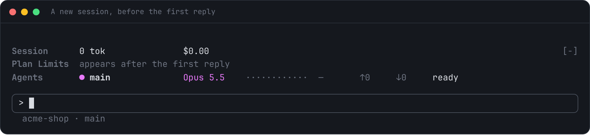
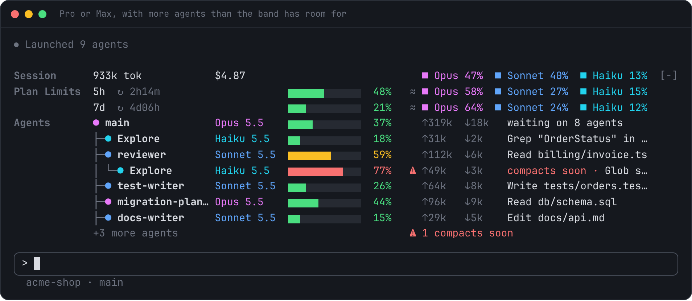
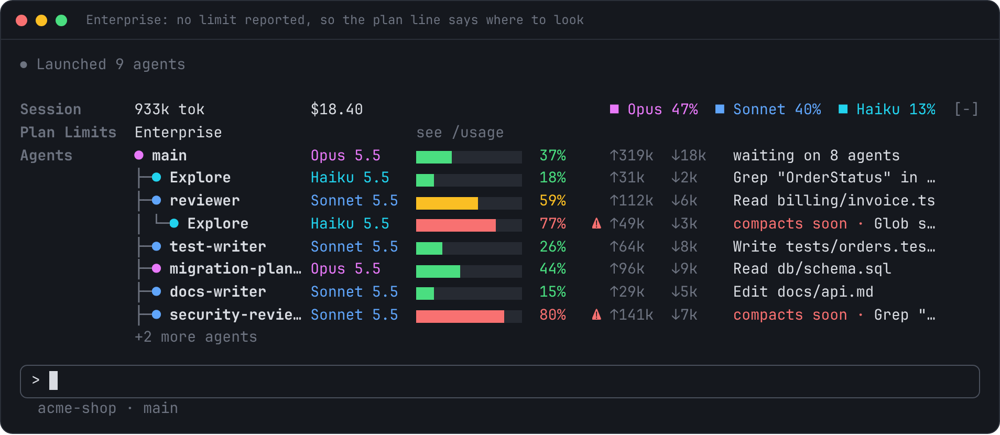
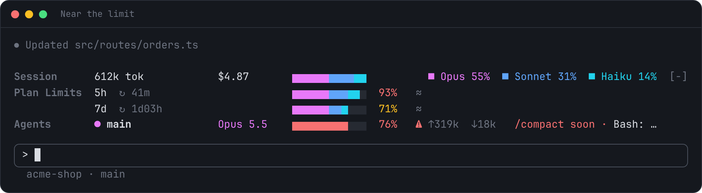
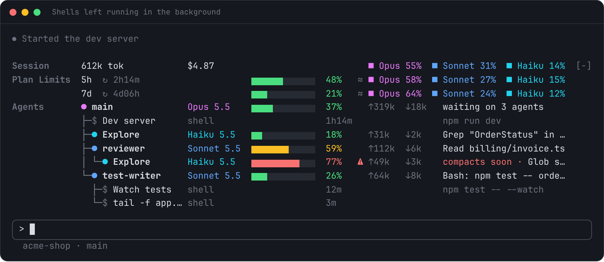
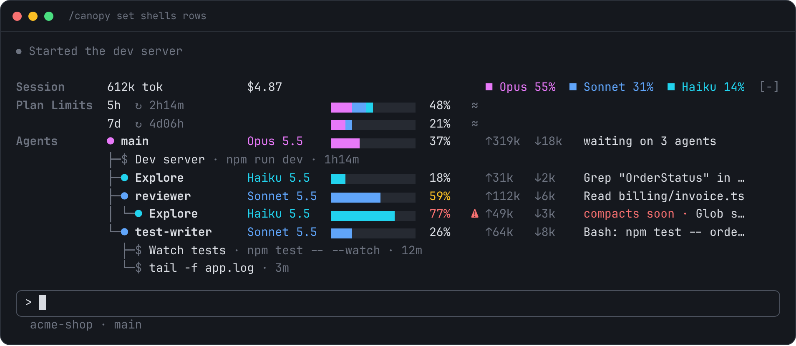
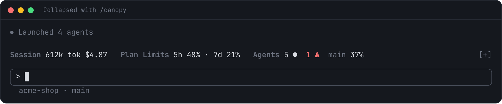
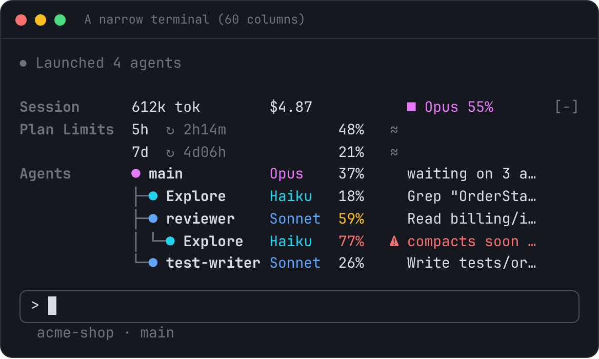
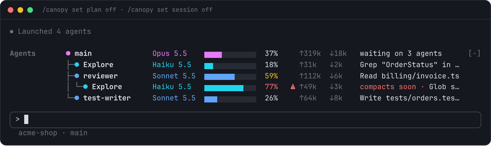
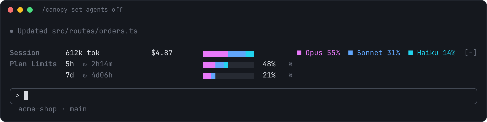

<div align="center">


# Context Canopy

Your session, plan limits and every running agent, in one band above the Claude Code prompt.

</div>

**A new session.** Your model shows straight away. The 5-hour and 7-day windows appear after Claude's first reply.



**Pro or Max.** The session by model, the 5-hour and 7-day windows, and every agent's context, tokens and current step. A tree taller than the band has room for ends with a row saying how many agents it hides.



**Enterprise, an API key or a cloud provider.** Claude Code gives plugins no limit or spend for these. In a terminal the plan line names your plan and says where to look instead: `see /usage` on Enterprise, or `no plan limit` for an API key or cloud provider. The session's cost and every agent show as usual.



## What it shows

| Line | What you see |
| --- | --- |
| **Session** | Tokens and cost for this session, and each model's share |
| **Plan** | Your plan's limits: how full each is, when it resets, and an estimate of which models used it. On Pro and Max that's the 5-hour and 7-day windows |
| **Agents** | Every running agent as a tree, however deep: its model, how full its context is, the tokens it has sent and received, how many shells it has left running in the background, and what it is doing right now |

Two rules keep it quick to read:

- **A bar's colours say which models filled it.** A plan window's bar is split by the models that used it, and an agent's context bar is its model's colour: **Fable** violet, **Opus** magenta, **Sonnet** blue, **Haiku** cyan. The session line's `■` shares are the key.
- **A number's colour says whether it needs a look.** Percentages stay plain while all is well, and turn **amber**, then **red**, as a plan window or an agent's context nears its limit. A calm band has almost no warning colour, so whatever needs you stands out.

## Install

You need Claude Code 2.1.309 or newer. There are two ways to install it. Pick one only: installing both shows two bands.

### Option 1: through my plugin marketplace (recommended)

Adds [jonw09/claude-plugins](https://github.com/jonw09/claude-plugins), then installs Context Canopy from it. My other plugins then show up in your plugin browser, ready to install if you want them. Nothing else is installed.

**In Claude Code** (at the prompt of a terminal session), run these one at a time:

```
/plugin marketplace add jonw09/claude-plugins
/plugin install context-canopy@jonw09
```

**From a shell:**

```
claude plugin install context-canopy --marketplace jonw09/claude-plugins
```

**In the desktop app:** click **+** next to the prompt box, choose **Plugins**, then **Add marketplace** and enter `jonw09/claude-plugins`, then **Add plugin**.

### Option 2: on its own

Installs Context Canopy straight from this repo, for when it's the only plugin of mine you want.

**In Claude Code:**

```
/plugin marketplace add jonw09/claude-context-canopy
/plugin install context-canopy@claude-context-canopy
```

**From a shell:**

```
claude plugin install context-canopy --marketplace jonw09/claude-context-canopy
```

**In the desktop app:** as above, but enter `jonw09/claude-context-canopy` as the marketplace.

When asked, press Enter to install for your user. The band appears straight away.

## Try it

Once installed, ask Claude for something that uses a few agents:

> explore this repo with three parallel agents

Watch the tree grow under `main`, each agent's context bar fill, and its current step change as it works. Agents drop off the tree the moment they finish.

## Reading the band

The band sits one blank row above the prompt box, with the session first, then the plan, then the agents.

### Session

Total tokens and cost for this session, and each model's share of the tokens. These follow Claude Code's own session cost:

- **Resuming a session** brings back its cost, and the tokens this machine saw it use.
- **`/clear`** starts a new session, so the cost and tokens start over.

The cost is Claude Code's own figure, as `/cost` shows it, worked out at API prices. On Pro and Max, that's what the session would have cost through the API, not what you pay.

### Plan



- The bar shows how full the window is, split into the colours of the models that used it. `≈` after the percentage marks that split as an estimate (see [Good to know](#good-to-know)). With `/canopy set split off`, or before there's anything to split by, the bar is one grey fill.
- The percentage turns **amber from 60%** and **red from 90%**, and you can move both with [`/canopy set`](#settings).
- `↻ 41m` is the time until the window resets. A full window reads `limited`.

The 5-hour and 7-day windows appear after Claude's first reply, when they're first reported.

**The row's name.** Claude Code doesn't give plugins your plan directly, so the row is headed **Plan Limits**.

**Team, Enterprise and API keys.** What the line shows depends on what Claude Code reports for your account:

| Account | What the plan line shows |
| --- | --- |
| Pro, Max, Team seats with usage limits | The 5-hour and 7-day windows |
| A Claude gateway's spend limit | `month`: how much of the limit is used |
| Enterprise and other seats billed by what they use | `Enterprise` (or your plan's name) and `see /usage`. Claude Code gives plugins no spend or spend limit, but its own `/usage` shows both |
| An API key | `API key` and `no plan limit`: you're billed per token, against no plan |
| A cloud provider (Amazon Bedrock, Google Vertex AI, Microsoft Foundry and others) | The provider's name and `no plan limit` |
| A gateway with no limit | `Cloud gateway` and `not reported` |

The plan's name comes from the plan line of Claude Code's welcome logo, which only the terminal draws. Where there's no logo to read, such as the desktop app, the line says `not reported` alone.

### Agents

Each row shows:

```
├─● test-writer     Sonnet 5.5  ▆▆▆▆▆▆▆▆▆▆▆▆  59%     ↑112k  ↓6k    $2  Bash: npm test -- orders
│ │                 │           │             │       │             │   └ what it is doing now
│ │                 │           │             │       │             └ shells it has left running in the background
│ │                 │           │             │       └ tokens sent ↑ and received ↓
│ │                 │           │             └ context used, of the full window: amber, then red, as it nears compacting
│ │                 │           └ context bar, in the model's colour
│ │                 └ model, in its colour
│ └ status: ● running  ◐ waiting  ◌ starting  ○ idle
└ tree guides showing who started whom
```

The tokens are counted the same way as the session line, so all the agents add up to the session's total. Main counts from the start of the session, and every other agent from its first request.

Context colours are tied to the point where Claude Code **auto-compacts** the conversation, not to the raw window size:

| Percentage | When | What to do |
| --- | --- | --- |
| Plain | under 60% of the way to auto-compact | nothing |
| 🟨 Amber | 60% to 89% of the way | long contexts start to lose quality from here |
| 🟥 Red, `⚠ compacts soon` | 90% of the way or more | consider `/compact`, or let it happen |

These are the same 60% and 90% points as the plan line, and [`/canopy set`](#settings) moves them for both.

The main row names your model from the start, and changes as soon as you switch with `/model`. If a request falls back to another model, the row shows the one that answered.

**Background shells.** A command an agent leaves running in the background, such as a dev server or a test watcher, is counted on that agent's row: `$2` is two shells. The count takes a column of its own, between the token counts and the activity, only while a shell is running, so the band never grows taller for them. It goes down as a command finishes or is stopped, and an agent's shells go when it ends. A command running in the foreground already shows as the agent's activity (`Bash: npm test`).



To see each shell, `/canopy set shells rows` gives each one a row of its own under its agent, with the whole row for what it is doing:

```
├─$ Dev server · npm run dev · 1h14m
│ │ │            │             └ how long it has run
│ │ │            └ its command
│ │ └ what Claude called it, or its command
│ └ $ marks a shell
└ under the agent that started it
```



`/canopy show` always lists them that way, as it has no height to keep to. `/canopy set shells off` hides them.

**A tall tree** is cut to fit the room Claude Code gives the band. With shells as rows, they give way first, so every agent keeps its row while there's room for it. The tree then ends with a row such as `+3 more agents, 2 shells`, adding `⚠ 1 compacts soon` if any of the hidden agents are near compacting. `/canopy show` prints the whole tree.

**Long agent names** get up to half as much room again in a terminal 120 columns or wider, before they're cut.

## Commands

| Command | What it does |
| --- | --- |
| `/canopy` | Collapse the band to one line, or expand it again |
| `/canopy collapse` / `/canopy expand` | Set it one way |
| `/canopy show` | Print the band as text (for places that can't draw it, see below) |
| `/canopy show 80` | The same, at a set width |
| `/canopy status` | Check whether the band can be drawn here, and any error |
| `/canopy set …` | Change a setting (see [Settings](#settings)) |
| `/canopy reset` | Put every setting back to its default |



In a narrow terminal the band drops the bars and token counts, shortens model names and keeps every percentage in its column:



## Settings

There's nothing to set up: the defaults suit most people. To change one, use `/canopy set`. Changes apply straight away and are kept for later sessions.

| Command | Default | What it does |
| --- | --- | --- |
| `/canopy set amber 70` | 60 | Turn a percentage amber from this %: of a plan window used, or of the way to auto-compact for context |
| `/canopy set red 95` | 90 | Turn red from this %, measured the same way |
| `/canopy set plan off` | on | The plan line |
| `/canopy set session off` | on | The session line |
| `/canopy set agents off` | on | The agent tree |
| `/canopy set shells rows` | count | Background shells: `count` on each agent's row, a row each with `rows`, or `off` |
| `/canopy set split off` | on | The plan bars' split by model, marked `≈` |

For example, to keep only the agent tree:

```
/canopy set plan off
/canopy set session off
```



Or to keep the session and plan lines, without the tree:

```
/canopy set agents off
```



## Where it works

| Where | Band | `/canopy show` |
| --- | --- | --- |
| Claude Code in a terminal | ✅ | ✅ |
| Claude desktop app (Code tab) | ✅ | ✅ |
| Claude mobile app or web, viewing a cloud session | ❌ the app doesn't draw plugin bands | ✅ |

In the desktop app the band is drawn in the app's code font, so its columns line up as they do in a terminal. From Claude Code 2.1.331 the bars and symbols keep to their columns too, even where that font lacks them. On earlier versions a symbol the font lacks can sit a little out of line.

If the band doesn't appear, run `/canopy status`. It lists which apps are attached and whether any of them asked for the band.

## Good to know

- **The plan's model shares are an estimate.** Claude reports one percentage per window, not a split by model. Context Canopy logs the usage it sees on this machine and splits each window by that. It can't see claude.ai or your other devices.
- **How tokens are counted.** Fresh input, output and cache writes count in full. Cache reads count at a tenth, which is how they're priced, so the totals reflect real usage rather than the same context re-read on every request. Each agent's ↑ sent and ↓ received counts work the same way.
- **Subagent windows.** Agents get a 200k context window, or 1M for `[1m]` models, unless they run on the same model as the main session.
- **Teammates in their own pane** show in the tree with `—` for context, because their usage isn't visible to this session.
- **Claude Code updates.** Context Canopy uses Claude Code's plugin API, which is still in early access, so a Claude Code update can occasionally break the band. If it disappears, run `/canopy status`, update the plugin, and [report a problem](https://github.com/jonw09/claude-context-canopy/issues) if that doesn't fix it.

## Privacy

Context Canopy keeps everything on your machine. It makes no network requests, reads no login, key or credential, calls no model, and sends nothing anywhere itself.

To show what each agent is doing, it reads the last tool call in each of Claude's replies: the tool's name and its main argument (a file path, command or search). To show the shells an agent leaves running, it reads that agent's newest conversation rows while it has a shell running or has just asked for one. It holds what it finds in memory for the session only. It saves only numbers on this machine (hourly token counts per model, each session's tokens per model, and your settings), never prompts, file names or content.

### What it fetches, runs and sends

- **Fetches:** nothing. It makes no network request of any kind.
- **Runs:** nothing. It runs no commands, starts no processes, and calls no tools or models. It doesn't hook tool calls or agent spawns, so it can't run, block or change one.
- **Sends:** nothing, to anywhere. What it draws stays in the band. `/canopy show` prints the band into your own conversation, where Claude Code treats it like any other command's output.
- **Credentials:** none. It never asks Claude Code for your login and reads no key, token or secret.

### What it hooks, and what it does with each

Context Canopy is a mod: code that hooks events in Claude Code. It reads what each event carries, and asks Claude Code for the session's usage, model and version, and the list of running agents. It passes every event on unchanged, except that it answers its own `/canopy` command and draws its band above the prompt. It changes no settings, instructions, tool descriptions or other hooks.

| Event | What it does |
| --- | --- |
| `session.start` | Loads its numbers and settings from this machine, registers `/canopy`, and reads Claude Code's version (so it draws the band in a way that version accepts), the session's model and its usage. Starts two timers: one that reads the list of running agents (each one's name, type, task description and status), the model and the usage every second, and one that saves its numbers every minute |
| `session.end` | Saves its numbers on this machine |
| `session.measure` | Reads the session's context size, auto-compact point, cost and plan limits |
| `turn.start`, `turn.complete` | Shows `thinking…` beside an agent while it waits for a reply, and clears what it shows when the agent's turn ends. At the start of a turn, looks in its text for a notice that a background shell has finished |
| `turn.step` | Before a helper agent's first request, notes the model it asks for and brings it into the tree. After each reply, reads its model and token counts, and the name and main argument of the last tool call it asks for, to show what that agent is doing. If the reply asks for a shell command, or the agent has a shell running, it reads the agent's newest conversation rows for the shell's start and finish. The request and the reply pass on unchanged |
| `command.run` | Answers `/canopy` itself. Every other command passes through untouched |
| `ui.render` | Draws the band above the prompt. Reads the plan line of Claude Code's welcome logo, and draws the logo as it is |

[PRIVACY.md](PRIVACY.md) sets out exactly what it reads, keeps and adds.

## Update or remove

From a shell (restart Claude Code after an update). Update the marketplace you installed from: `jonw09` for option 1, `claude-context-canopy` for option 2.

```
claude plugin marketplace update jonw09
claude plugin update context-canopy
claude plugin disable context-canopy
claude plugin uninstall context-canopy
```

## Licence

[MIT](LICENSE) © 2026 jonw09
